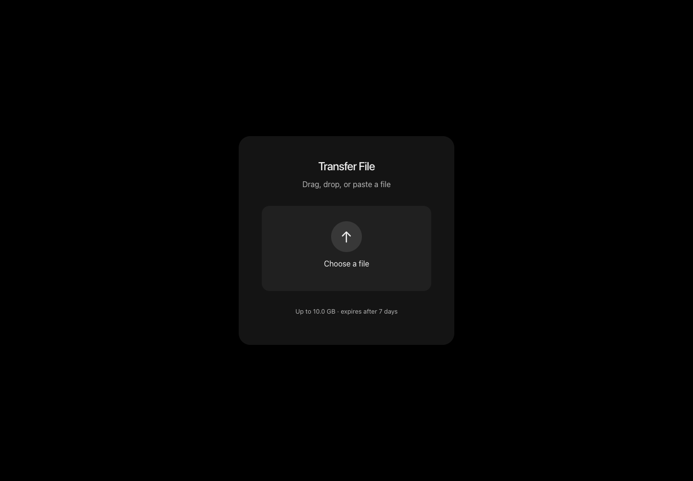

# File Transfer

A small file-sharing application with a three-step flow: upload a file, copy its link, and download it. Files and link metadata stay on disk, so links survive a server restart.



## Run locally

Requires Node.js 24.11 or newer. [Download the source](https://github.com/blvgor/file-transfer-app/archive/refs/heads/main.zip), extract it, and open a terminal in the project folder:

```sh
npm ci
npm run build
npm start
```

Open **http://127.0.0.1:3000**. The same Node.js server serves the interface and upload API. No separate frontend deployment or external storage account is required for local use.

## Features

- Drag-and-drop, file picker and file paste.
- Upload progress and a shareable download page.
- Unicode filenames and streamed binary downloads.
- Byte-range requests for download clients.
- Persistent links, expiry and automatic cleanup.
- Responsive desktop and mobile interface.

## Configuration and hosting

Set these values in the server environment when needed:

| Variable | Default | Purpose |
| --- | --- | --- |
| `HOST` | `127.0.0.1` | Server bind address |
| `PORT` | `3000` | Server port |
| `UPLOADS_DIR` | `backend/uploads` | Persistent file and metadata storage |
| `MAX_FILE_SIZE` | `10737418240` | Maximum upload size in bytes (10 GiB) |
| `RETENTION_DAYS` | `7` | Time before files expire |
| `FRONTEND_URL` | Local Vite origins | Allowed origins for a separately hosted interface |

Local links are reachable only on the machine running the server. Sharing with other people requires a public Node.js host, HTTPS and persistent disk storage. A static frontend deployment alone cannot store uploads. Keep storage outside an ephemeral deployment directory and configure upload limits to match your server capacity.

Anyone with a link can download the file until it expires. The application does not provide user accounts, passwords or end-to-end encryption. The 10 GiB default is configurable; the verification used small binary fixtures rather than a full-size upload.

Expired uploads are cleaned at startup and every six hours. Run `npm run cleanup` for an immediate cleanup.

## Verification

```sh
npm test
```

Tests cover Unicode and binary round trips, byte and suffix ranges, invalid requests, persisted links, size limits, expiry and cleanup. The upload/link/download flow and an actual server restart were also checked in a browser on desktop and mobile.

Built with React, TypeScript, Vite and Hono.
